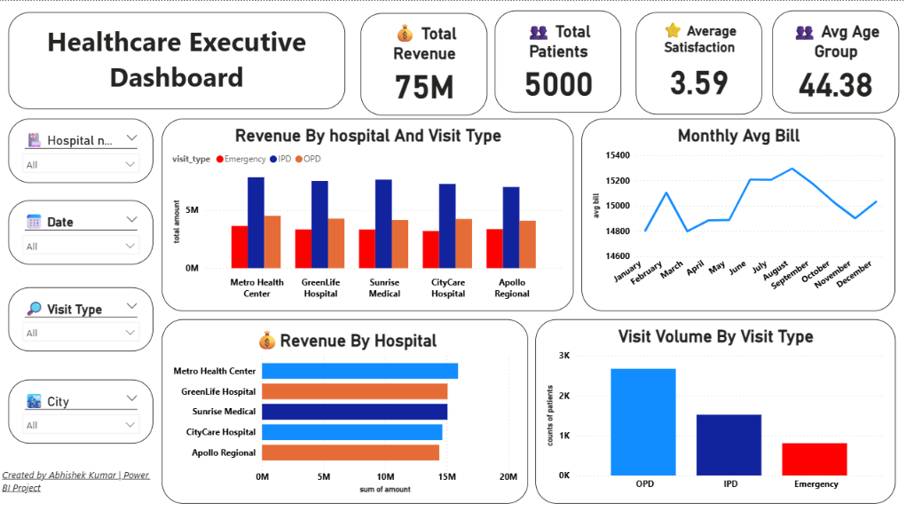

<div align="center">

# 🏥 Healthcare Executive Dashboard (Power BI)

**One-page Power BI dashboard on 5,000 patient visits that shows hospital revenue, patient volume and satisfaction at a glance.**




</div>

---

## 📌 Overview

Hospital leaders need a quick answer to three questions: how much revenue each hospital brings in, where patient volume comes from, and how satisfied patients are. This dashboard puts those answers on one page, with filters for hospital, date, visit type and city.

## 📂 Dataset

| | |
|---|---|
| **File** | [`data/healthcare_visits.csv`](data/healthcare_visits.csv) |
| **Rows** | 5,000 patient visits (one row per patient) |
| **Period** | January – December 2023 |
| **Coverage** | 5 hospitals in 5 cities; visit types OPD, IPD and Emergency |
| **Columns (17)** | patient age and gender, chronic condition, hospital, city, latitude/longitude, visit date, visit type, length of stay, total bill, insurance type, lab tests ordered, 30-day readmission, satisfaction score |

## 📊 KPIs

| KPI | Value |
|---|---|
| 💰 Total Revenue | 75.1M |
| 👥 Total Patients | 5,000 |
| ⭐ Average Satisfaction | 3.59 / 5 |
| 🎂 Average Patient Age | 44.4 years |

## 📈 Visuals

- Revenue by hospital and visit type (clustered bar)
- Monthly average bill trend (line)
- Revenue by hospital (bar)
- Visit volume by visit type (column)
- Slicers: hospital, date, visit type, city

## 🔍 Key Insights

- **OPD brings the most patients, IPD brings the most money.** OPD is 53% of visits (2,672) but IPD, with 30% of visits (1,521), earns 49% of revenue (37.1M).
- **IPD is the top revenue source at every hospital** in the revenue-by-visit-type chart.
- **Metro Health Center leads revenue (15.9M)**, but all five hospitals sit in a narrow band (14.4M – 15.9M).
- **The average bill per visit is about 3x higher for IPD (24.4K) than for OPD (7.9K).**
- **Data quality note:** 287 visits have no satisfaction score, so the 3.59 average is based on the remaining 4,713.

## 🛠️ Approach

1. **Prepare** the CSV in Power Query.
2. **Measure** the KPIs with DAX: revenue, patient count, average satisfaction and average age.
3. **Design** a one-page executive layout: KPI cards on top, comparison charts below, slicers on the left.

## 📁 Repository Structure

```
healthcare-executive-dashboard/
├── data/
│   └── healthcare_visits.csv                 # 5,000 patient visits (2023)
├── dashboard/
│   └── healthcare_executive_dashboard.pbix   # Power BI report
├── images/
│   └── dashboard.png                         # dashboard screenshot
└── README.md
```

## ▶️ How to Open

1. Install [Power BI Desktop](https://powerbi.microsoft.com/desktop/) (free).
2. Open `dashboard/healthcare_executive_dashboard.pbix`.
3. Use the slicers on the left to filter by hospital, date, visit type or city.

---

## 👤 Author

**Abhishek Kumar** · MIS Data Analyst  
[LinkedIn](https://www.linkedin.com/in/abhikumar8762/) · [GitHub](https://github.com/abhishek8762a) · [Portfolio](https://abhishek-portfolio-8762.vercel.app) · [Email](mailto:abhiyadav8762@gmail.com)
